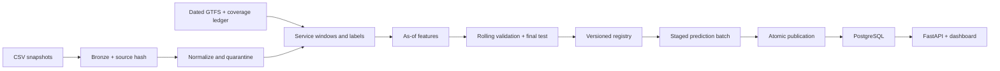

# TTC Delay Risk

**A reproducible research model for TTC incident severity by route and hour.**

[](https://github.com/NotMyFault8/ttc-delay-risk/actions/workflows/ci.yml)

Current real-data target: the probability that a recorded TTC incident has `Min Delay >= 15`, conditional on route and local calendar. This is a probability **among incident records**, not the chance that a bus or service hour experiences a delay. The threshold is configurable.

**Status:** trained and retrospectively evaluated on real snapshots. Validation selected CatBoost using 2025+ records over candidates including 2023. Test ROC-AUC is 0.829; Brier is 0.1681 versus 0.1699 for the frequency baseline. Prospective validity remains unverified. [Model definition, results and commands](docs/severity-model.md) · [Evaluation JSON](reports/severity-evaluation.json). This project is independent of TTC and the City of Toronto.

```sh
python -m ttc_delay_risk.severity train --root data/severity \
  --inputs /path/to/ttc-bus-delay-data-2023.xlsx.zip /path/to/current.csv
python -m ttc_delay_risk.severity predict --root data/severity --date FUTURE-YYYY-MM-DD
```

The commands below document the **legacy service-hour incidence prototype**, including its synthetic dashboard. That target still requires historical schedules and coverage evidence. Conditional-severity outputs have their own artifact directory and JSON fields and are not served as incidence probabilities by that dashboard.

## Try it in five minutes

Python 3.10–3.12:

```sh
python -m venv .venv
. .venv/bin/activate
pip install -r requirements.lock
pip install --no-deps .
python -m unittest discover -s tests -v
ttc-pipeline demo --root data/demo
DATABASE_URL=sqlite:///data/demo/predictions.db uvicorn ttc_delay_risk.api:create_app --factory
```

Open **http://127.0.0.1:8000**, select **2025-07-01**, and view the ranking. Interactive API documentation is at `/docs`. The demo deliberately returns HTTP 503 from `/ready`: historical synthetic results do not make a production service ready.

### PostgreSQL deployment

```sh
cp .env.example .env
# Set a local alphanumeric password in .env.
docker compose up -d --build api
docker compose --profile demo run --rm demo
```

The API binds to localhost. PostgreSQL stays on the private Compose network. Model artifacts and source data are excluded from Git.

## What is implemented

| Layer | Capabilities |
| --- | --- |
| Ingestion | HTTPS retries, SHA-256 source versions, immutable raw snapshots, schema checks, row quarantine |
| Samples | Dated GTFS bus services, calendar exceptions, after-midnight times, coverage-aware labels |
| Features | Shared as-of feature builder; calendar, scheduled trips, smoothed historical frequencies |
| Evaluation | Baseline, logistic regression, CatBoost; three temporal folds and a held-out final period |
| Registry | Code/data hashes, dependencies, seed, metrics, versioned artifacts, manual release and rollback |
| Batch serving | Idempotent staged batches, transactional publication, baseline fallback and explicit status |
| API | Health, readiness, paginated predictions, risk ranking, model version and compact dashboard |
| Operations | Run ledger, Docker/PostgreSQL, daily timer template, CI and recovery tests |

## Architecture



## Evidence, not promises

**Legacy ingestion audit:** `reports/source-audit.json` describes an earlier snapshot (102,257 rows, through 2026-08-31) used in the service-hour prototype. The conditional-severity model instead uses the source snapshots and row counts in [its model report](reports/severity-evaluation.json). Parsed route IDs are not automatically verified bus services. [Source assessment](docs/data-assessment.md).

**Synthetic evaluation:** 2,184 windows across 182 days. The validation gate selected the historical-frequency baseline. The final test is preserved for all three candidates; no test-period result changes model selection. [Evaluation report](docs/evaluation.md) · [Detailed metrics](reports/demo-evaluation.json).

**Verification:** tests cover data leakage, calendars, DST, revisions, quarantine, replay, publication, corrupt-artifact fallback and API constraints. See [operations evidence](docs/operations.md) for measured local deployment checks and limitations.

## Work with real data

```sh
ttc-risk --file /path/to/ttc-bus-delay-data-since-2025.csv --output data

ttc-dataset --schedules schedules.json --events events.json \
  --coverage coverage.json --start 2025-01-01 --end 2025-06-30 \
  --codes REVIEWED_CODE --output data/windows.json

ttc-pipeline train --dataset data/windows.json --evidence evidence.json
# Review the generated candidate report before release:
ttc-pipeline release --version CANDIDATE_VERSION
```

The evidence file is a manual research attestation, not an automatic proof. Do not set its flags without documented source review. [Input contracts and runbook](docs/operations.md) explain manifests, backfills and publication.

## Design boundaries

- No event record means **no recorded event**, not proof of punctual vehicles.
- Historic features use only labels available at the prediction cutoff.
- Current GTFS cannot establish historical service; missing coverage leaves labels unknown.
- Python transformations, SQLAlchemy, a systemd timer template and a local Docker Airflow DAG are implemented. Airflow supports ingestion and explicit conditional-severity training/prediction operations. Its 03:30 Toronto scheduled runs default to ingestion.
- Frequency-based GTFS requires explicit expansion and is rejected. The conditional-severity workflow reads historical XLSX and current CSV snapshots.
- Cloud deployment, prospective real-data validation, a 14-day operating record and cloud cost measurement remain outstanding. No SLA or operational business improvement is claimed.

## Code map

`pipeline.py` ingestion · `gtfs.py` calendars · `dataset.py` labels · `features.py` as-of statistics · `model.py` evaluation/registry · `run.py` batch commands · `store.py` transactions · `api.py` queries/dashboard.

`severity_data.py` CSV/XLSX event preparation · `severity.py` conditional severity, cohort selection, temporal evaluation and future scenario scores.

[Engineering decisions](docs/engineering.md) · [Data assessment](docs/data-assessment.md) · [Evaluation](docs/evaluation.md) · [Operations](docs/operations.md)
