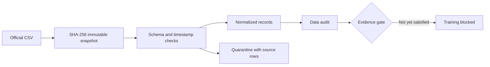

# TTC Delay Risk

**An auditable foundation for forecasting recorded bus delay events in Toronto.**

[](https://github.com/NotMyFault8/ttc-delay-risk/actions/workflows/ci.yml)

The intended prediction unit is **bus route × operating date × hour**. The objective is to rank windows for an analyst's limited attention budget, not predict vehicle arrival times.

## Current status

The source-auditing and ingestion foundation is implemented and tested. **This is not yet a trained or deployed prediction system.** Training is gated on verified event coverage, historical schedules, and publication availability. An absent record does not prove a bus ran on time.

### Measured source audit

| Check | Result |
| --- | ---: |
| Source rows | 102,257 |
| Normalized rows | 100,547 |
| Quarantined rows | 1,710 |
| Exact duplicate candidates, retained | 298 |
| Distinct parsed route IDs | 266 |
| Event date range | 2025-01-01 to 2026-08-31 |

These counts describe one downloaded snapshot, not confirmed service coverage. See the [machine-readable audit](reports/source-audit.json) and [data assessment](docs/data-assessment.md).

## Run locally

Python 3.10+; the pipeline has no third-party runtime dependencies.

```sh
python -m venv .venv
. .venv/bin/activate
python -m pip install .
python -m unittest discover -s tests -v

ttc-risk --file /path/to/ttc-bus-delay-data-since-2025.csv --output data
```

Download the CSV from the [official source](https://open.toronto.ca/dataset/ttc-bus-delay-data/), or supply its HTTPS resource URL with `--url` instead of `--file`. The current parser targets the **2025+ CSV schema**; legacy Excel workbooks require a separate adapter.

```sh
docker build -t ttc-risk .
docker run --rm -v "$PWD/data:/data" ttc-risk --file /data/input.csv --output /data/output
```

Docker configuration is provided; the container has not yet been exercised in deployment.

## How it works



- Re-ingesting identical bytes reuses the same content-addressed snapshot.
- Revised source files receive distinct hashes and retain earlier versions.
- Invalid rows preserve their original values and source line numbers.
- Toronto timestamps are converted to UTC; ambiguous or nonexistent local times are quarantined.
- Duplicate candidates are reported, not silently deleted.
- First observation time is never substituted for historical publication time.

## Repository map

| Location | Purpose |
| --- | --- |
| `src/ttc_delay_risk/` | Ingestion, normalization, auditing, evidence guard |
| `tests/` | Idempotency, revisions, schema, time and quarantine tests |
| `reports/` | Small measured outputs; no raw datasets |
| `docs/` | Data assessment, contracts and development milestones |
| `.github/workflows/` | Automated tests on Python 3.10 and 3.12 |

## Next acceptance gates

1. Verify historical GTFS validity and a documented coverage/publication policy.
2. Build service windows, mature labels and point-in-time features.
3. Compare smoothed historical frequency, logistic regression and a tree model with rolling validation and an untouched final test period.
4. Implement transactional prediction publication, PostgreSQL/FastAPI serving and recovery tests.
5. Deploy and measure operation, latency and cost; collect at least 14 days of run evidence.

See [engineering decisions and milestones](docs/engineering.md). No predictive accuracy, business improvement, deployment or uptime claim is made at this stage.

Independent portfolio work; not affiliated with or endorsed by TTC or the City of Toronto. Source data remains subject to its publisher's terms; see [data assessment](docs/data-assessment.md).
